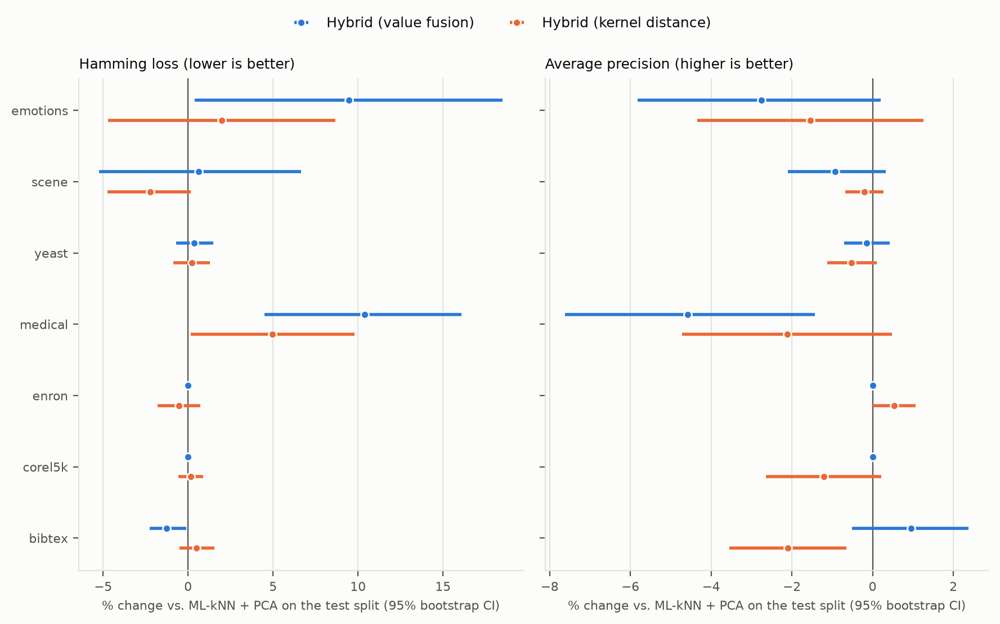
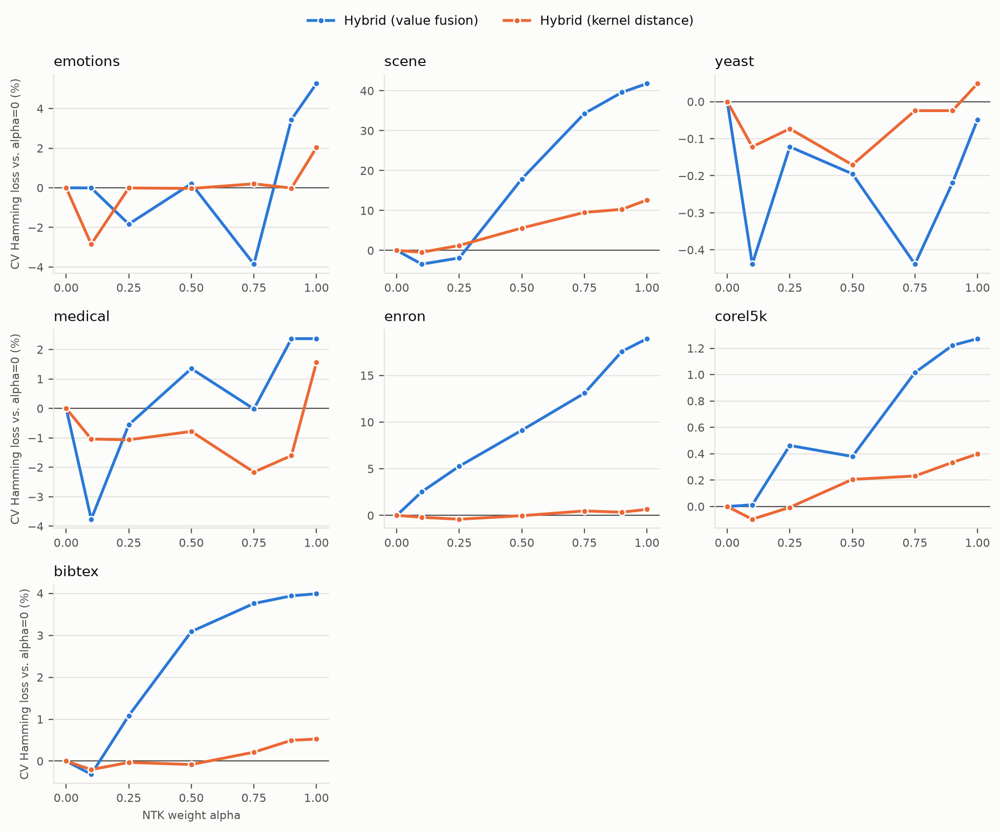

# NTK neighbourhoods for multi-label kNN

Can the Neural Tangent Kernel (NTK) of an infinitely wide network give multi-label kNN better neighbours than plain distance?
This repository holds a hybrid NTK + RBF neighbourhood for ML-kNN and a cross-validated study of it on seven standard benchmarks.
It includes statistical tests and an analysis of when and why NTK neighbourhoods fail.

The project grew out of my MS thesis in Data Science at FAST-NUCES (2025), supervised by Dr Atif Tahir.

## Summary

1. **Mixing NTK into the neighbourhood gives significant gains on some datasets, but no consistent improvement.**
   Each method was tuned by 5-fold cross-validation and compared on the test split with paired bootstrap confidence intervals.
   The value-fusion hybrid is significantly better than ML-kNN on PCA features in 5 of 28 comparisons (dataset × metric × selection criterion), significantly worse in 4, and indistinguishable in 19.
   Its clearest gain is on bibtex: Hamming loss −1.3%, and micro-F1 0.354 vs 0.324.
2. **Ranking neighbours by raw NTK value creates "hub" neighbours.** The NTK grows with input norm, so a few large-norm training points become everyone's neighbours. On bibtex, a single training point is among the 10 neighbours of 2,098 of the 2,515 test examples.
   NTK neighbourhoods ranked this way are worse than Euclidean ones on 6 of 7 datasets.
   Ranking by the kernel-induced distance removes the hubs, and makes NTK neighbourhoods statistically indistinguishable from Euclidean ones on 4 of the 7.
3. **On dense-feature datasets, most of the gain over plain ML-kNN comes from PCA.** PCA significantly lowers Hamming loss on scene, enron and bibtex. On medical (sparse text features) it significantly lowers average precision.
   On scene, for example, the steps are:
   - ML-kNN: 0.0969;
   - adding PCA: 0.0879;
   - adding NTK at weight 0.1: 0.0860, a borderline improvement whose confidence interval just crosses 0.
4. **Choosing configurations by test score would overstate the hybrid.** On 6 of the 7 datasets, the best test-set Hamming loss in its 729-configuration grid beats the cross-validated choice, by up to 15% (emotions).
5. **Two properties simplify the method.** RBF neighbours are exactly Euclidean neighbours. The infinite-width NTK does not depend on hidden-layer widths.

## The method

ML-kNN (Zhang & Zhou, 2007) predicts each label of an example from how many of its *k* nearest training neighbours carry that label.
The hybrid changes how those neighbours are found. After standardising the features and reducing them with PCA, it ranks training points by a fused similarity:

    similarity(x, y) = alpha * NTK(x, y) + (1 - alpha) * RBF(x, y)

* **NTK** is the Neural Tangent Kernel (Jacot et al., 2018) of an infinitely wide two-hidden-layer ReLU network: a *global*, angle-based similarity.
  It is computed in closed form (Arora et al., 2019) and checked against neural-tangents (Novak et al., 2019).
* **RBF**, exp(−gamma‖x − y‖²), is a *local*, distance-based one.

Six method families are compared, each tuned separately:

| Family | Neighbourhood |
|---|---|
| ML-kNN | Euclidean distance on standardised features |
| ML-kNN + PCA | Euclidean distance on PCA features (the hybrid at alpha = 0, for every gamma) |
| NTK (raw) | Raw NTK value (the hybrid at alpha = 1) |
| NTK (distance) | NTK-induced distance K(x,x) + K(y,y) − 2K(x,y) |
| Hybrid (value fusion) | alpha · NTK + (1 − alpha) · RBF ranked by value, alpha ∈ {0, 0.1, 0.25, 0.5, 0.75, 0.9, 1} |
| Hybrid (kernel distance) | The same fusion (NTK rescaled to unit mean self-similarity) ranked by induced distance |

Grid: PCA components {30, 50, 80}, gamma ∈ {0.001, 0.01, 0.1, 1, 10}, k ∈ {5, 10, 15}, smoothing s ∈ {0.5, 1, 2}. That is 1,440 configurations per dataset.

## Evaluation protocol

* **Datasets.** Seven MULAN benchmarks (Tsoumakas et al., 2011) with their standard train/test splits: emotions, scene, yeast, medical, enron, Corel5k and bibtex.
* **Tuning.** 5-fold cross-validation on the training split chooses each family's configuration, by mean Hamming loss and, separately, by mean average precision. The scaler and PCA are refit inside every fold.
  On exact ties the simpler configuration (smaller NTK weight) wins, so the NTK has to earn its place.
* **Testing.** The test split is used once, for the chosen configurations.
* **ML-kNN.** Training points never count as their own neighbours. The implementation matches scikit-multilearn's (`tests/test_mlknn.py`).
* **Metrics.** Hamming loss, subset accuracy and micro/macro-F1 from 0/1 predictions. Ranking loss, average precision, one-error and coverage from ML-kNN's posterior scores. All match scikit-learn (`tests/test_metrics.py`).
* **Significance.** Paired bootstrap over test examples, 2,000 resamples, 95% intervals.

## Results

Test-split scores of each method's cross-validated choice, selected by mean CV Hamming loss. **Bold** marks the best score on each dataset.
Full tables are in [`results/summary.md`](results/summary.md): subset accuracy, macro-F1, ranking loss, one-error and coverage, plus selection by average precision.

**Hamming loss** (lower is better)

| Dataset | ML-kNN | ML-kNN + PCA | NTK (raw) | NTK (distance) | Hybrid (value fusion) | Hybrid (kernel distance) |
|---|---|---|---|---|---|---|
| emotions | 0.2153 | 0.2096 | 0.2360 | **0.2063** | 0.2294 | 0.2137 |
| scene | 0.0969 | 0.0879 | 0.1182 | 0.1028 | 0.0885 | **0.0860** |
| yeast | 0.1987 | 0.1987 | **0.1984** | 0.1989 | 0.1994 | 0.1992 |
| medical | **0.0223** | 0.0229 | 0.0256 | 0.0241 | 0.0253 | 0.0240 |
| enron | 0.0543 | 0.0492 | 0.0587 | **0.0488** | 0.0492 | 0.0489 |
| corel5k | 0.0093 | **0.0092** | 0.0094 | **0.0092** | **0.0092** | **0.0092** |
| bibtex | 0.0150 | 0.0130 | 0.0135 | 0.0131 | **0.0128** | 0.0130 |

**Average precision** (higher is better)

| Dataset | ML-kNN | ML-kNN + PCA | NTK (raw) | NTK (distance) | Hybrid (value fusion) | Hybrid (kernel distance) |
|---|---|---|---|---|---|---|
| emotions | 0.7859 | **0.8017** | 0.7519 | 0.7856 | 0.7797 | 0.7894 |
| scene | 0.8529 | **0.8593** | 0.8098 | 0.8260 | 0.8513 | 0.8576 |
| yeast | 0.7577 | **0.7584** | 0.7570 | 0.7580 | 0.7573 | 0.7545 |
| medical | **0.6991** | 0.6745 | 0.5912 | 0.6424 | 0.6436 | 0.6603 |
| enron | 0.6133 | 0.6631 | 0.5365 | **0.6692** | 0.6631 | 0.6666 |
| corel5k | 0.2679 | **0.3368** | 0.2947 | 0.3215 | **0.3368** | 0.3328 |
| bibtex | 0.2670 | 0.5036 | 0.3856 | 0.4581 | **0.5084** | 0.4930 |

**NTK weight chosen by cross-validation:**

| Hybrid | emotions | scene | yeast | medical | enron | corel5k | bibtex |
|---|---|---|---|---|---|---|---|
| Value fusion | 0.75 | 0.1 | 0.1 | 0.1 | 0 | 0 | 0.1 |
| Kernel distance | 0.1 | 0.1 | 0.5 | 0.75 | 0.25 | 0.1 | 0.1 |

**Are the differences real?** The table counts datasets on which each method beats ML-kNN + PCA, using a paired bootstrap on test examples (2,000 resamples, 95% CI excluding 0).

| Configurations selected by CV… | Method | Hamming loss: better / same / worse | Average precision: better / same / worse |
|---|---|---|---|
| Hamming loss | NTK (raw) | 0 / 1 / 6 | 0 / 1 / 6 |
| Hamming loss | NTK (distance) | 0 / 4 / 3 | 0 / 3 / 4 |
| Hamming loss | Hybrid (value fusion) | 1 / 4 / 2 | 0 / 6 / 1 |
| Hamming loss | Hybrid (kernel distance) | 0 / 6 / 1 | 1 / 5 / 1 |
| Average precision | Hybrid (value fusion) | 2 / 4 / 1 | 2 / 5 / 0 |
| Average precision | Hybrid (kernel distance) | 0 / 7 / 0 | 0 / 7 / 0 |



*Change relative to ML-kNN + PCA on the test split, with 95% paired-bootstrap intervals; configurations selected by CV Hamming loss. An interval that crosses 0 means no detectable difference.*



*Best mean CV Hamming loss at each NTK weight, relative to alpha = 0. Each interior point is the best of 135 configurations and each endpoint the best of 27, so small dips partly reflect having more chances.*

**Choosing by test score instead of cross-validation** ([`results/optimism.csv`](results/optimism.csv)): with test-set selection, the hybrid's 729-configuration grid would report a lower Hamming loss than its cross-validated choice on 6 of 7 datasets (emotions 0.1955 instead of 0.2294; scene 0.0849 instead of 0.0885).
On emotions, scene and yeast it would also pick a positive NTK weight that cross-validation does not support.
The 27-configuration ML-kNN + PCA grid is affected much less, so the larger grid gains more from test-set selection.

## Why raw NTK neighbourhoods fail: hubs

For this ReLU network, NTK(x, y) is proportional to ‖x‖ ‖y‖, times a function of the angle between x and y.
Ranking training points by NTK(query, x) therefore favours large-norm points, whatever the query is.
The result is an extreme form of hubness, the tendency of a few points to appear in many nearest-neighbour lists (Radovanović et al., 2010).

`ntk_mlknn/diagnostics.py` (PCA 50, k = 10, test queries) measures it.
The table shows the share of all neighbour slots taken by the 10% of training points with the largest norm; 10% would be neutral.

| Dataset | Euclidean | NTK, raw value | NTK, distance | Most test queries served by a single training point (raw NTK) |
|---|---|---|---|---|
| emotions | 1% | **68%** | 1% | 126 of 202 |
| scene | 3% | **62%** | 2% | 905 of 1,196 |
| yeast | 12% | **20%** | 10% | 36 of 917 |
| medical | 0% | **94%** | 0% | 645 of 645 |
| enron | 5% | **99.7%** | 5% | 460 of 579 |
| corel5k | 5% | **87%** | 3% | 441 of 500 |
| bibtex | 3% | **97%** | 2% | 2,098 of 2,515 |

Ranking by the kernel-induced distance K(x,x) + K(y,y) − 2K(x,y) removes the effect: it is the difference between the "NTK (raw)" and "NTK (distance)" columns in the results.
Yeast, the only dataset where raw-NTK neighbours were competitive, is also the only one with little hub effect.

## Two properties of the method

**RBF neighbours are Euclidean neighbours.** exp(−gamma·d²) decreases with distance d, so the *k* most RBF-similar points are exactly the *k* nearest points, for every gamma.
On its own, the RBF kernel does not change ML-kNN. Gamma matters only as a weight against the NTK term, and at alpha = 0 the hybrid is ML-kNN on PCA features.
(At large gamma, exp underflows to 0 for most pairs, so ranking ties are broken arbitrarily.)

**The NTK does not depend on hidden-layer widths.** The infinite-width NTK depends on depth and weight variance only, so the widths are not a hyper-parameter.
For example, (64, 32) and (128, 64) give the same kernel. `ntk_mlknn/kernels.py` computes it in closed form; `tests/test_kernels.py` checks it against neural-tangents for several widths.

## Running the experiments

Python 3.11, CPU only. The full cross-validated run takes about 1.5 hours on a laptop and needs about 1.5 GB of free memory for the two largest datasets. Completed folds are checkpointed, so an interrupted run resumes.

```bash
python -m venv .venv && .venv/bin/pip install -r requirements.txt   # .venv\Scripts\ on Windows
python scripts/download_data.py          # 7 MULAN datasets -> data/ (checksummed)
python -m pytest                         # 21 checks
python -m ntk_mlknn.experiment           # cross-validated evaluation, all datasets -> results/<dataset>/
python -m ntk_mlknn.diagnostics          # hub diagnostic -> results/neighbour_diagnostics.csv
python -m ntk_mlknn.report               # results/summary.md, CSVs, figures
```

## Repository layout

| Path | What it is |
|---|---|
| `ntk_mlknn/` | Data loading, ML-kNN, kernels, metrics, experiment, diagnostics, report |
| `tests/` | Checks against scikit-multilearn, neural-tangents and scikit-learn, and against MULAN's published split sizes |
| `results/` | Per-dataset grids (CV and test scores of all 1,440 configurations), selected configurations, summary tables, figures |
| `scripts/download_data.py` | Downloads and checksums the MULAN datasets |

## References

* M.-L. Zhang, Z.-H. Zhou. ML-KNN: A lazy learning approach to multi-label learning. *Pattern Recognition* 40(7):2038–2048, 2007. doi:[10.1016/j.patcog.2006.12.019](https://doi.org/10.1016/j.patcog.2006.12.019)
* A. Jacot, F. Gabriel, C. Hongler. Neural Tangent Kernel: Convergence and Generalization in Neural Networks. arXiv:[1806.07572](https://arxiv.org/abs/1806.07572), 2018.
* S. Arora, S. S. Du, W. Hu, Z. Li, R. Salakhutdinov, R. Wang. On Exact Computation with an Infinitely Wide Neural Net. arXiv:[1904.11955](https://arxiv.org/abs/1904.11955), 2019.
* R. Novak, L. Xiao, J. Hron, J. Lee, A. A. Alemi, J. Sohl-Dickstein, S. S. Schoenholz. Neural Tangents: Fast and Easy Infinite Neural Networks in Python. arXiv:[1912.02803](https://arxiv.org/abs/1912.02803), 2019.
* M. Radovanović, A. Nanopoulos, M. Ivanović. Hubs in Space: Popular Nearest Neighbors in High-Dimensional Data. *JMLR* 11:2487–2531, 2010.
* G. Tsoumakas, E. Spyromitros-Xioufis, J. Vilcek, I. Vlahavas. MULAN: A Java Library for Multi-Label Learning. *JMLR* 12:2411–2414, 2011.

## Citation and licence

See `CITATION.cff`. MIT-licensed (`LICENSE`).
